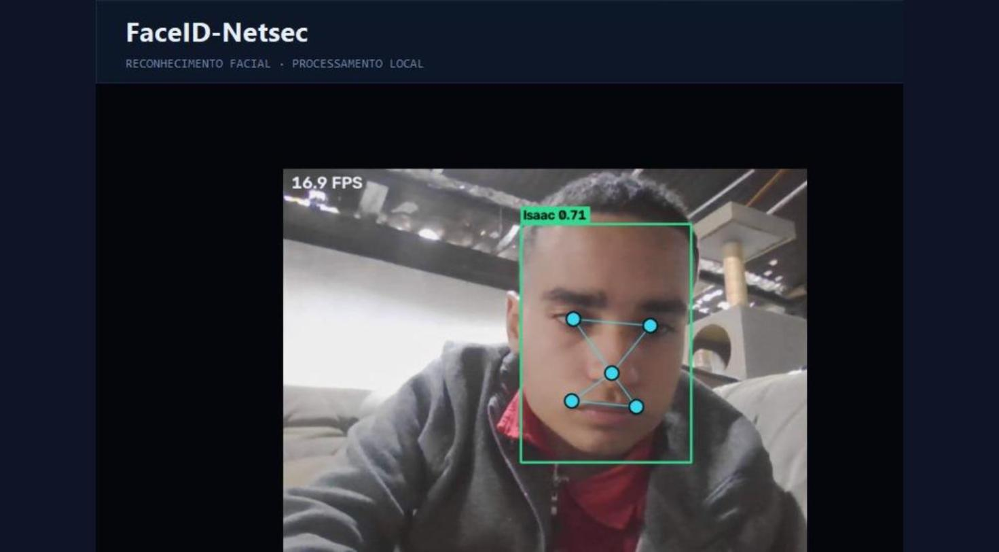
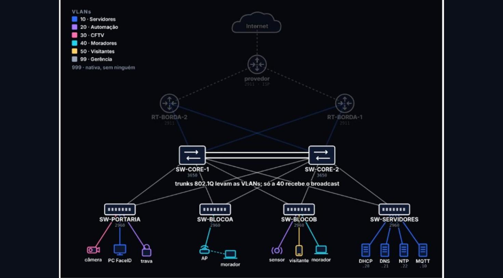

# FaceID Netsec

Sistema de portaria que reconhece o morador pelo rosto e libera a entrada. Montei esse projeto no curso técnico de redes da FIEB e apresentei na Expotech 2026. A rede que sustenta o sistema, que chamei de Condomínio Seguro, foi desenhada e simulada no Cisco Packet Tracer.



## Como o reconhecimento funciona

Tudo roda local, em Python, sem mandar imagem para serviço nenhum de fora. São dois modelos trabalhando juntos. O YuNet acha o rosto na imagem e marca cinco pontos de referência: os dois olhos, o nariz e os cantos da boca. O SFace pega esse rosto e transforma numa assinatura numérica, que é comparada com a dos moradores já cadastrados. A pontuação dessa comparação é o que decide se a entrada é liberada ou negada.

O processamento local chega a 30 FPS.

## A tela do porteiro


O painel foi feito em Node-RED. Ele mostra a foto de quem acabou de chegar, o nome, se o acesso foi liberado ou negado e a semelhança do reconhecimento. Embaixo ficam os contadores e o registro com o horário de cada entrada. Numa das rodadas de teste deram 42 acessos, sendo 26 liberados e 16 negados.

## A rede: Condomínio Seguro



A topologia é hierárquica: internet, provedor, dois roteadores de borda 2911, dois núcleos 3650 ligados por EtherChannel e quatro switches de acesso 2960, um na portaria, um em cada bloco e um para os servidores.

### As VLANs

| VLAN | Função | O que fica nela |
|---|---|---|
| 10 | Servidores | DHCP, DNS, NTP e broker MQTT |
| 20 | Automação | Trava e sensores |
| 30 | CFTV | Câmeras |
| 40 | Moradores | PCs e celulares dos moradores |
| 50 | Visitantes | Rede de visitantes |
| 99 | Gerência | Administração dos equipamentos |
| 999 | Nativa | Sem nenhum dispositivo |

### 1. VLANs e 802.1Q

A rede é dividida em 6 VLANs por função, então o broadcast de um morador só chega a quem está na VLAN 40. As portas de usuário ficam em modo access e sem negociar trunk, e a VLAN nativa dos trunks é a 999, que não tem nenhum dispositivo. Isso fecha a porta para switch spoofing e double tagging.

```
SW-BLOCOA(config)# interface fa0/13
SW-BLOCOA(config-if)# switchport mode access
SW-BLOCOA(config-if)# switchport access vlan 40
SW-BLOCOA(config)# interface range gi0/1 - 2
SW-BLOCOA(config-if-range)# switchport trunk native vlan 999
SW-BLOCOA(config-if-range)# switchport nonegotiate
```

### 2. EtherChannel com LACP

Os dois núcleos se ligam por dois cabos agrupados num Port-channel. A banda total dobra, mas cada fluxo vai por um cabo só, escolhido por hash. Se um cabo cai, o link continua de pé e o spanning-tree nem precisa reconvergir. O Port-channel também é trunk, então leva as VLANs entre os núcleos.

```
SW-CORE-1(config)# interface range gi1/0/1 - 2
SW-CORE-1(config-if-range)# channel-group 1 mode active
SW-CORE-1# show etherchannel summary
```

### 3. Rapid-PVST+

Cada switch de acesso tem um uplink para cada núcleo. O Rapid-PVST+ roda uma árvore por VLAN: encaminha por um uplink e bloqueia o outro, que fica de reserva e assume em segundos se o ativo cair. Dividi a raiz entre os dois núcleos para o tráfego não ficar todo em cima de um só.

```
SW-CORE-1(config)# spanning-tree mode rapid-pvst
SW-CORE-1(config)# spanning-tree vlan 10,20,99,999 priority 24576
SW-CORE-1(config)# spanning-tree vlan 30,40,50 priority 28672
```

### 4. HSRP v2

Cada VLAN tem um IP virtual compartilhado pelos dois núcleos. Um deles é o Active e responde por esse IP; se cair, o outro assume o mesmo IP e o mesmo MAC virtual quando o hold time vence. Com preempt, o papel de Active volta para o titular quando ele se recupera. Em cada VLAN o Active também é a raiz do spanning-tree.

```
SW-CORE-1(config-if)# standby version 2
SW-CORE-1(config-if)# standby 10 ip 10.10.10.1
SW-CORE-1(config-if)# standby 10 priority 150
SW-CORE-1(config-if)# standby 10 preempt
```

### 5. OSPF na área 0

Núcleos e roteadores de borda viram vizinhos OSPF na área 0. Os roteadores aprendem as redes das VLANs e a resposta da internet encontra o caminho de volta. Os roteadores anunciam a rota padrão, e com `passive-interface default` nenhuma porta de usuário fala OSPF.

```
SW-CORE-1(config-router)# passive-interface default
SW-CORE-1(config-router)# no passive-interface vlan999
RT-BORDA-2(config-router)# default-information originate
```

### 6. NAT seletivo

O roteador de borda só traduz as VLANs 10, 40 e 50, então o morador navega normalmente. A câmera, na VLAN 30, não tem tradução: o pacote até sai, mas com IP privado e sem caminho de volta pela internet.

```
RT-BORDA-1(config)# access-list 111 permit ip 10.10.0.0 0.0.255.255 any
RT-BORDA-1(config)# ip nat inside source list 111 interface gi0/0 overload
RT-BORDA-1# show ip nat translations
```

### 7. DHCP falso contra DHCP Snooping

Um único servidor DHCP atende todas as VLANs, porque o `ip helper-address` no núcleo transforma o broadcast do cliente num pedido direto ao servidor. No ataque, alguém liga um servidor DHCP falso numa porta comum e, se ele responder primeiro, o cliente aceita o gateway dele. O DHCP Snooping só aceita OFFER e ACK vindos de porta confiável, que são os uplinks e a porta do servidor de verdade, então a resposta falsa é descartada. Ele também monta a tabela de vínculos de MAC, IP, porta e VLAN que a inspeção de ARP usa no passo seguinte.

```
SW-CORE-2(config-if)# ip helper-address 10.10.10.20
SW-BLOCOB(config)# ip dhcp snooping vlan 10,20,30,40,50
SW-BLOCOB(config)# no ip dhcp snooping information option
SW-BLOCOB(config-if)# ip dhcp snooping trust
```

### 8. ARP poisoning contra Dynamic ARP Inspection

No ARP poisoning o atacante manda respostas ARP falsas dizendo que o IP do gateway pertence ao MAC dele. Os aparelhos da VLAN atualizam a tabela ARP e passam a mandar o tráfego para o atacante, que pode ler ou alterar os dados antes de repassar. O Dynamic ARP Inspection confere cada ARP que chega por porta não confiável contra a tabela do DHCP Snooping, e se o par de IP e MAC não bate o ARP é descartado.

```
SW-BLOCOB(config)# ip arp inspection vlan 40,50
```

### 9. Port-Security

O port-security com sticky grava o MAC do primeiro aparelho que usa a porta. Se alguém desconectar o PC da portaria e ligar outro aparelho no lugar para tentar entrar na VLAN 10 dos servidores, o MAC diferente dispara a violação. No modo restrict o switch descarta o tráfego do aparelho estranho e registra a violação, sem derrubar a porta.

```
SW-PORTARIA(config-if-range)# switchport mode access
SW-PORTARIA(config-if-range)# switchport port-security
SW-PORTARIA(config-if-range)# switchport port-security mac-address sticky
SW-PORTARIA(config-if-range)# switchport port-security violation restrict
```

### Serviços

DHCP com relay, DNS e NTP ficam todos na VLAN 10, junto com o broker MQTT que os dispositivos de automação usam para conversar.

## O que eu fiz no projeto

Cuidei da arquitetura do sistema inteiro, da captação do rosto até a decisão de acesso e a exibição do resultado para o porteiro, e da integração dessas partes num fluxo só. Na parte de rede, escolhi e configurei os comandos Cisco no Packet Tracer.

## Sobre mim

Sou Isaac Ramos Pereira, de Barueri, SP. Estou no Técnico em Redes de Computadores da FIEB, no ITB Brasílio Flores de Azevedo, e já concluí três cursos da Cisco Networking Academy: IT Essentials, CCNA Introduction to Networks e CCNA Switching, Routing and Wireless Essentials.

Estou atrás da primeira oportunidade em TI, e dá para falar comigo pelo [LinkedIn](https://www.linkedin.com/in/isaac-ramos-pereira-526273328).
